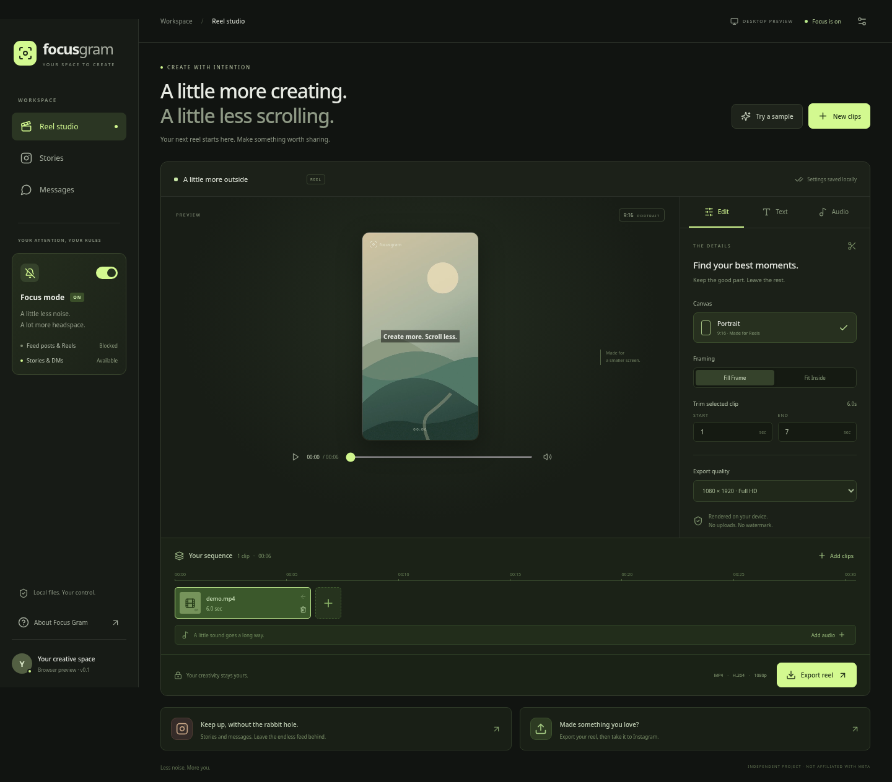

<div align="center">


# Focus Gram

### Create more. Scroll less.

A Linux-first reel studio and focused Instagram workspace.<br/>
Trim your clips, make your reel, and keep up with Stories without opening the endless feed.

[](https://github.com/wizard142/focus-gram/actions/workflows/ci.yml)


</div>



## Why this exists

Sometimes you open Instagram to post a reel or check a friend's Story, and spend the next half hour scrolling. Focus Gram is an experiment in keeping the useful parts of Instagram close while making space to create.

It combines a local video editor with an isolated Instagram web workspace. It does **not** reproduce Instagram's mobile app or unlock mobile-only features.

## What works in v0.1

- Import multiple local video clips and preview them.
- Trim each clip, reorder your sequence, and remove clips.
- Fill a portrait canvas or fit the full image with letterboxing.
- Add a text overlay and choose its position.
- Mix original audio with a local soundtrack; control both volumes.
- Render 720p or 1080p portrait MP4s with FFmpeg. Exports have no Focus Gram watermark.
- Open Instagram in a persistent, separate, sandboxed session.
- Turn on focus mode to hide home-feed articles and post/Reel/Explore links, and block those routes. Stories and DMs remain accessible.
- Draft and copy a caption, then open Instagram to upload through its own Create flow.

**The editor and FFmpeg pipeline are tested. Instagram filtering has automated DOM fixture tests, but authenticated Stories, messaging, and uploading have not been verified with a real account.** Instagram changes its layout and may reject embedded browsers. This is an early alpha, not a promise of complete Instagram compatibility. See [limitations](docs/LIMITATIONS.md).

## Run on CachyOS / Arch Linux

Requires Node.js **22.12+**, npm, `ffmpeg`, and `ffprobe` (both provided by the FFmpeg package). Current Node LTS is recommended.

```bash
sudo pacman -S --needed nodejs npm ffmpeg git

git clone https://github.com/wizard142/focus-gram.git
cd focus-gram
npm ci
npm start
```

If your npm configuration blocks Electron's install script and you see “Electron failed to install correctly,” run `node node_modules/electron/install.js`, then retry `npm start`.

Log in directly to Instagram inside the Stories or Messages workspace. Focus Gram has no account registration, password form, analytics, or hosted backend. Camera/microphone permission requests are currently denied, so calling is not supported.

### Browser preview

```bash
npm run dev
```

Open the local URL printed by Vite. Browser preview supports video import, preview, trim and editor controls. FFmpeg export and the embedded Instagram workspace require Electron. “Try a sample” loads an original generated landscape clip; import a local video to export.

### Package for Linux

```bash
npm run pack  # unpacked desktop app in release/linux-unpacked/
npm run dist  # AppImage and tar.gz in release/
```

FFmpeg is a system dependency and is not bundled. Electron's Linux sandbox must remain enabled; don't work around startup issues with `--no-sandbox`. Your distribution must support unprivileged user namespaces or a correctly configured Electron sandbox. Run AppImages with `--appimage-extract-and-run` if FUSE is unavailable.

## How focus mode works

The local editor and remote Instagram content run in separate renderers. The Instagram renderer has no Node.js access and no app preload bridge. Session cookies stay in Electron's application data on the current device.

With focus enabled, the app:

1. Injects CSS that hides home-feed articles, post links, Reel links, and Explore links. It avoids hiding login forms and Story viewer articles.
2. Blocks navigation to `/p/`, `/reel/`, `/reels/`, and `/explore/` routes, including single-page navigation.
3. Preserves `/stories/`, `/direct/`, account login routes, and creation routes.

Focus mode is an attention aid, not a parental control or network content firewall. It does not filter Instagram's underlying API responses. A layout change, new route, embedded content in a message, or an Instagram experiment can affect coverage. Profile post links are also hidden when focus is enabled. Turn focus off to deliberately browse posts.

## Publishing

Export first, then open the publishing card, copy your caption, and upload with Instagram's Create button. This is Instagram's web uploader, with its existing account and format restrictions.

Direct API publishing is **not implemented**. Meta's Instagram publishing APIs serve eligible professional accounts and require app setup and permissions. They do not provide a full replacement for the mobile app. No unofficial mobile endpoints, extracted session tokens, or hidden auto-posting are used.

## Development and checks

```bash
npm test                    # route/validation tests and real FFmpeg integration
npx playwright install chromium
npm run test:ui             # browser interactions + focus DOM fixtures
npm run build
node tests/desktop.mjs      # native Electron smoke test; requires a display and FFmpeg
```

Use `FG_CHROMIUM=/usr/bin/chromium npm run test:ui` to test with system Chromium. Native tests use a temporary profile and mocked file dialogs, not your Instagram login.

Stack: React, Vite, Electron `WebContentsView`, Lucide icons, system FFmpeg. See [architecture](docs/ARCHITECTURE.md), [privacy](docs/PRIVACY.md), and [contributing](CONTRIBUTING.md).

## Next

- Test authenticated Instagram flows on more Linux desktops.
- Add project save/reopen with missing-file recovery.
- Improve captions, text layout, and timeline seeking.
- Add a tested professional-account publishing integration if there is demand.

MIT licensed. Independent community project; not affiliated with, endorsed by, or sponsored by Instagram or Meta. Instagram is a trademark of its respective owner.
