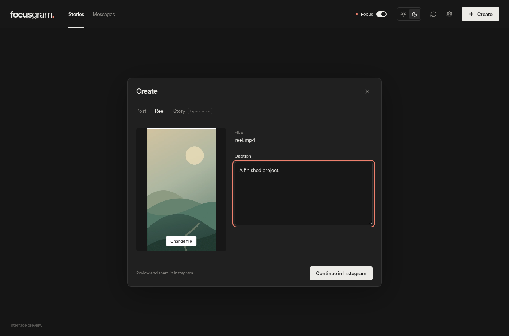

# Focus Gram

A focused Instagram app for Linux.

## Native desktop app

The new native shell runs the real Instagram Android app inside a GTK window. **Create** opens your desktop file picker; only the selected file goes into Instagram’s editor. **Focus** covers feed posts and blocks Reels/Explore while keeping the Stories tray, DMs and creation editors available.

It uses KVM, a smaller render surface, host OpenGL, Quick Boot, and automatic pause when minimized. Fast reopen keeps Android paused in memory after closing; **Quit completely** releases it. Android remains the main resource cost.

See [native setup and requirements](native/README.md). This source version uses a configured official Google Play emulator; SDK images, account data and the local signing key are not included in the repository.

```sh
bash native/companion/build.sh
bash native/install.sh
bash native/launch.sh
```

The focus helper has no network permission and does not save screen contents. It is a local screen filter whose selectors may need updates when Instagram changes.

## Earlier web client — v0.2.1

The downloadable v0.2.1 AppImage below is the earlier Electron/web client, with the limitations described here.

Instagram takes up the window. A small toolbar adds focus mode, light/dark themes, and file upload controls. Edit videos in your normal editor; Focus Gram no longer includes a video editor.



## Features

- **Focus mode:** hide home-feed posts, Reels and Explore while keeping Stories and messages.
- **Light and dark themes:** saved locally, including Instagram's appearance.
- **Post / Reel:** select a finished photo or MP4, load it into Instagram's actual composer, and finish sharing there. A caption is copied for pasting. No project export or download step.
- **Experimental Story uploads:** publish a photo or a video up to 60 seconds using your existing Instagram session. Works through an unofficial integration intended for personal accounts; requires explicit enablement and acknowledgement before each publication.

## Important limits

Story uploads use [instagrapi](https://github.com/subzeroid/instagrapi), not a supported Meta API. They may fail or trigger account verification. Story uploading has been reported working on one personal account. Automated tests use real local dependencies and mocked upload responses; they do not publish to a real account. Mobile-only music, stickers, effects and calls are not included. This is not full mobile-app parity.

Instagram can change its markup, block embedded login, or reject a session imported from the web client. Composer transfer and focus filtering have browser and native fixture tests, not a guarantee for every account or Instagram release. Finish normal post/Reel publication in Instagram; only the experimental Story button publishes immediately.

## Install on CachyOS / Arch

[Download the Linux alpha](https://github.com/wizard142/focus-gram/releases/tag/v0.2.1), or run from source:

```bash
sudo pacman -S --needed nodejs npm ffmpeg git python

git clone https://github.com/wizard142/focus-gram.git
cd focus-gram
npm ci
npm start
```

Requires Node.js 22.12+ and FFmpeg/ffprobe for video metadata and Story preparation. If your npm setup blocks Electron's install script, run `node node_modules/electron/install.js` before starting.

### Upload a post or Reel

1. Sign in directly to Instagram inside the app.
2. Click **Create**, choose **Post** or **Reel**, and select a finished file.
3. Click **Continue in Instagram**. Review it in Instagram's composer, paste your caption if provided, and share.

The transfer selects the file in Instagram's own file input using Electron's DevTools protocol. It does not press Instagram's final Share button. If Instagram's Create button cannot be located, Focus Gram reports the failure and you can open the uploader manually.

### Upload a Story — experimental

1. Open **Create → Story** and enable the experimental integration.
2. Click **Set up** once. This creates a local Python virtual environment in the app's data directory and installs pinned `instagrapi==3.2.1` dependencies from PyPI. Python 3.11+ and internet access are required; Debian/Ubuntu users may also need `python3-venv`.
3. Choose a photo or MP4. Prepare edits, audio and text in an external editor first.
4. Check the acknowledgement and click **Publish Story**. This publishes immediately; there is no separate Instagram review screen.

No Instagram password is requested by the helper. The current app session is passed privately to the local helper over stdin, never through process arguments or repository files. It is not saved as a second session file. Credentials stay in the existing Electron session. If Instagram asks for verification, stop and complete it in Instagram before another attempt. If publication is unconfirmed, check your Story before retrying to avoid duplicates.

### Themes

Use the sun/moon buttons in the toolbar, or Settings → Appearance. The app saves your preference locally and updates Electron's native theme plus Instagram's theme classes.

## Development

```bash
npm run dev                  # browser preview; no account or uploads
npm test                     # route and composer tests
npm run test:stories          # Python helper tests, no network
npx playwright install chromium
npm run test:ui               # browser controls and focus fixtures
npm run test:desktop          # isolated native fixture tests, no real posts
npm run dist                 # Linux AppImage and tarball
```

Set `FG_CHROMIUM=/usr/bin/chromium` to use system Chromium. Set `FG_TEST_STORY_SETUP=1` for native tests to install/check the Python runtime in their temporary app profile. Native tests require a Linux display. Tests never reuse your real Instagram profile.

Don't disable Electron's sandbox to work around packaging problems. Use `--appimage-extract-and-run` if your system lacks FUSE.

[Architecture](docs/ARCHITECTURE.md) · [Privacy](docs/PRIVACY.md) · [Limitations](docs/LIMITATIONS.md) · [Contributing](CONTRIBUTING.md)

Instrument Sans is bundled under the [SIL Open Font License](docs/FONT-LICENSE.txt). Focus Gram is MIT licensed, independent, and not affiliated with Instagram or Meta.
